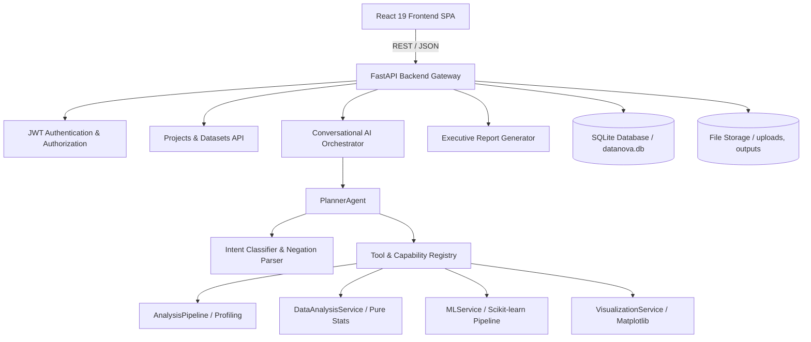

# DataNova AI — Architecture Overview

## 1. System Architecture

DataNova AI is a full-stack, enterprise-grade data analysis and machine learning platform. It couples a modern single-page frontend (React 19, Vite, Tailwind CSS v4) with an asynchronous Python backend (FastAPI, SQLAlchemy, Scikit-learn, Pandas, Groq LLM).

---

## 2. Core Subsystems

### A. Frontend Layer (`frontend/`)
- **Framework:** React 19 + Vite with client-side SPA routing (`react-router-dom` v7).
- **Design System:** Semantic CSS custom properties (`--dn-*`), Tailwind CSS v4, Lucide icons.
- **ChatGPT-Style Sidebar:** Collapsed by default (icons only), expands smoothly on hover or via manual pin toggle. Content flows horizontally with zero overlay disruption.
- **State Management:** React Context providers:
  - `AuthContext`: Manages user credentials, demo access, guest isolation, and token refresh.
  - `ProjectContext`: Handles optional project switching, active project tracking, and dashboard defaults.
  - `DatasetContext`: Restores active dataset profiles, summaries, and schemas.
  - `ChatContext`: Manages persistent conversation history and message card rendering.
  - `ThemeContext`: Handles dark/light theme persistence and anti-flash DOM initialization.

### B. Backend API Layer (`backend/app/api/`)
- **FastAPI Application:** RESTful endpoints with CORS, structured Pydantic schemas, and JWT dependencies.
- **Key Modules:**
  - `auth.py`: User registration, authentication, demo account login, guest access, and token renewal (`/auth/refresh`).
  - `projects.py`: CRUD operations for projects with user ownership isolation.
  - `datasets.py`: Upload ingestion, schema inspection, dataset activation, and deletion.
  - `chat.py`: Natural language AI analysis gateway connecting users with the planning engine.
  - `conversations.py`: Multi-turn message history persistence and restoration.
  - `analysis.py`: Historical analytics and static chart asset retrieval.
  - `report.py`: Automated HTML report compilation and token-protected delivery.
  - `tasks.py`: Audit trail of executed platform tools and capabilities.

### C. AI Planning & Execution Engine (`backend/app/core/`)
- **Planner Agent:** Formulates structured execution plans from user queries with token-budget optimization (<300 tokens history context) and negation clause stripping.
- **Deterministic Routing:** Automatically routes text-only exploratory data analysis queries through local profiling and grounded statistical services without consuming LLM token quotas.
- **Tool Registry:** Dynamic catalog of certified analytical, visualization, and machine learning tools.
- **Grounded Synthesis:** Statistical calculations are performed on actual data matrices and passed to LLM services for narrative synthesis.
