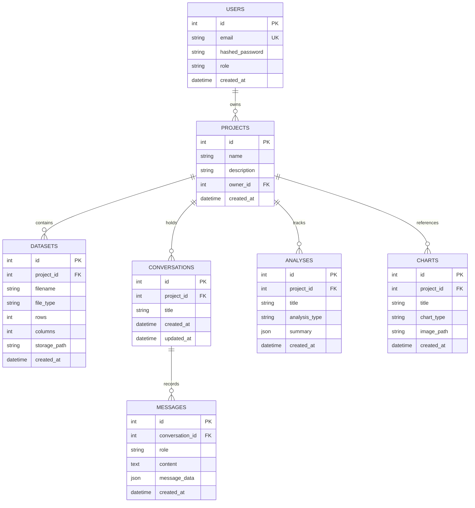

# DataNova AI — Database Architecture & Schema

The application uses **SQLAlchemy ORM** backed by **SQLite** (`backend/datanova.db`) in development and production deployments. Strict foreign key constraints and user ownership isolation are enforced at the database and application levels.

---

## Entity Relationship Model

---

## Key Design Principles
1. **Multi-Tenant Project Isolation:** Every data entity (`Dataset`, `Conversation`, `Message`, `Analysis`, `Chart`) belongs to a `Project`, and every `Project` is strictly mapped to an `owner_id`.
2. **Ephemeral Guest Handling:** Guest users receive a special virtual token (`id=0`, `is_guest=True`) without polluting the database with transient account records.
3. **Structured Card Payloads:** Complex AI tool outputs (profiling tables, correlation matrices, code snippets, evaluation metrics) are stored in `messages.message_data` as JSON, enabling identical UI card reconstruction on browser reload.
